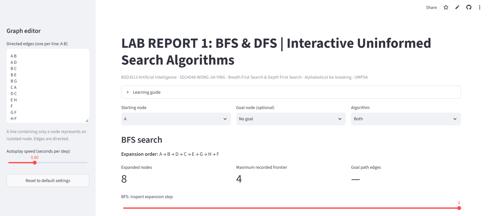
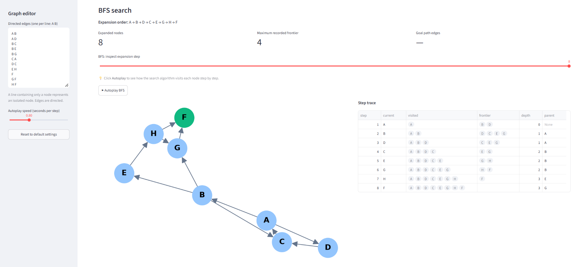
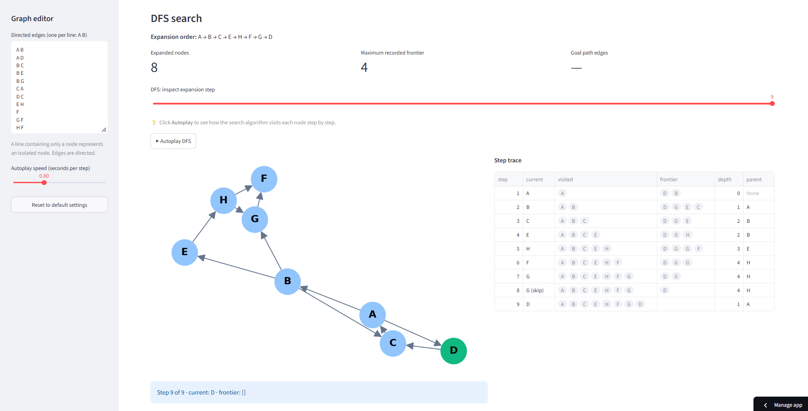
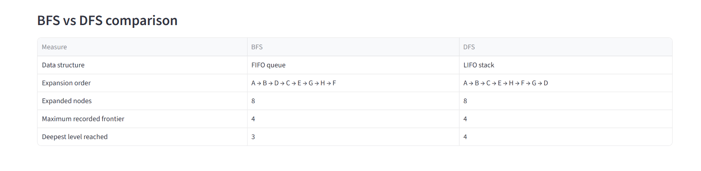

# 🔎 Search Explorer: BFS vs DFS on a Directed Graph

**BSD3513 Introduction to Artificial Intelligence · Lab Report 1**

SD24048 WONG JIA YING · Universiti Malaysia Pahang Al-Sultan Abdullah (UMPSA)

🌐 **Live app:** [https://lab-report-1-4dbaejccwqcel55glfrhsb.streamlit.app/](https://lab-report-1-4dbaejccwqcel55glfrhsb.streamlit.app/)

💻 **Source code:** [https://github.com/wongjiaying-wjy/Lab-Report-1](https://github.com/wongjiaying-wjy/Lab-Report-1)



## About
This project is an interactive Streamlit web app for studying two uninformed search strategies, **Breadth-First Search (BFS)** and **Depth-First Search (DFS)**. It runs both on a directed graph and shows, step by step, which node is expanded, what is waiting in the frontier and which path leads to the goal. Whenever a node has several neighbours, they are visited in **alphabetical order** (tie-breaking rule from the lab question).

## Key features
- **Build your own graph:** enter directed edges in the sidebar, or just use the Lab 1 graph that loads automatically.
- **Choose how to search:** set the starting node, add a goal node if you want one, and run BFS, DFS or both together.
- **Step through the search:** drag the slider to any expansion step and see the current node, visited list, frontier, depth and parent at that moment.
- **Play the animation:** click the **▶ Autoplay** button to watch the graph update one node at a time, and use the sidebar slider to speed it up or slow it down.
- **See the differences at a glance:** when both algorithms run, a comparison table lists the data structure, expansion order, nodes expanded, frontier size, deepest level and goal path.
- **Reset in one click:** the reset button in the sidebar brings back all the default settings.

## Screenshots
| BFS run | DFS run |
|---|---|
|  |  |

**BFS vs DFS comparison**



## Default graph (Lab 1)
```
A → B, D      B → C, E, G      C → A      D → C
E → H         F → (none)       G → F      H → F, G
```

Expansion order starting from **A** (alphabetical tie-breaking):

| Algorithm | Data structure | Expansion order |
|---|---|---|
| BFS | FIFO queue | A → B → D → C → E → G → H → F |
| DFS | LIFO stack | A → B → C → E → H → F → G → D |

## How to run it on your computer
1. Download or clone this repository.
2. Open a terminal in the project folder.
3. Install the dependencies and launch the app:

```bash
pip install -r requirements.txt
streamlit run "Lab Report 1.py"
```

The app opens in your browser, usually at `http://localhost:8501`.

## Graph input format
Enter one directed edge per line in the sidebar:

```
A B        # edge A → B
A,C        # commas also work
F          # a lone node (no edges)
```

Text after `#` is ignored. Node names are case-insensitive and the graph is limited to 100 nodes.

## Code overview (`Lab Report 1.py`)

| Function | Purpose |
|---|---|
| `normalize()` | Cleans node names, removes duplicate edges and sorts neighbours alphabetically |
| `edges_from_text()` | Parses and validates the edge list typed in the sidebar |
| `search()` | Runs BFS (queue) or DFS (stack) and returns the order, path, trace and statistics |
| `draw_graph()` | Draws the graph with the current node in green and visited nodes in blue |
| `reset_defaults()` | Restores the default settings stored in session state |

## Repository layout
```
Lab Report 1.py      # Streamlit application
requirements.txt     # Python dependencies
image/               # Images used in this README
```

## Built with
Python · Streamlit · NetworkX · Matplotlib · pandas

## Complexity note
For an adjacency-list graph, both BFS and DFS run in **O(V + E)** time. BFS always finds a path with the fewest edges in an unweighted graph, whereas DFS may return a longer one.
